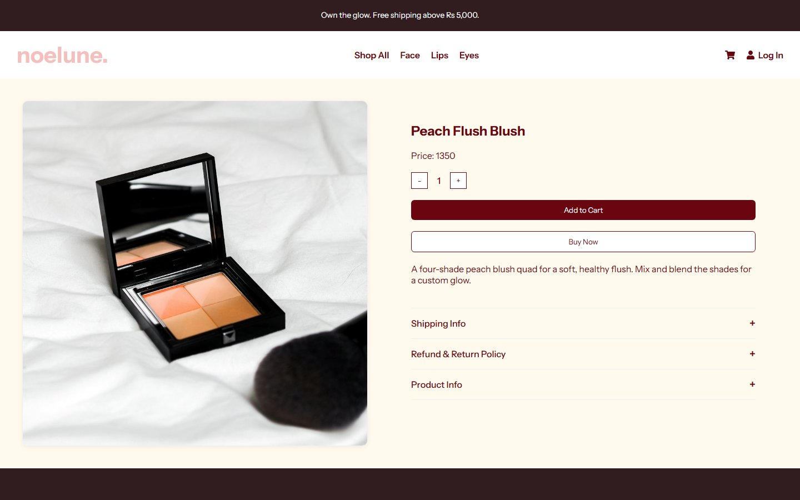
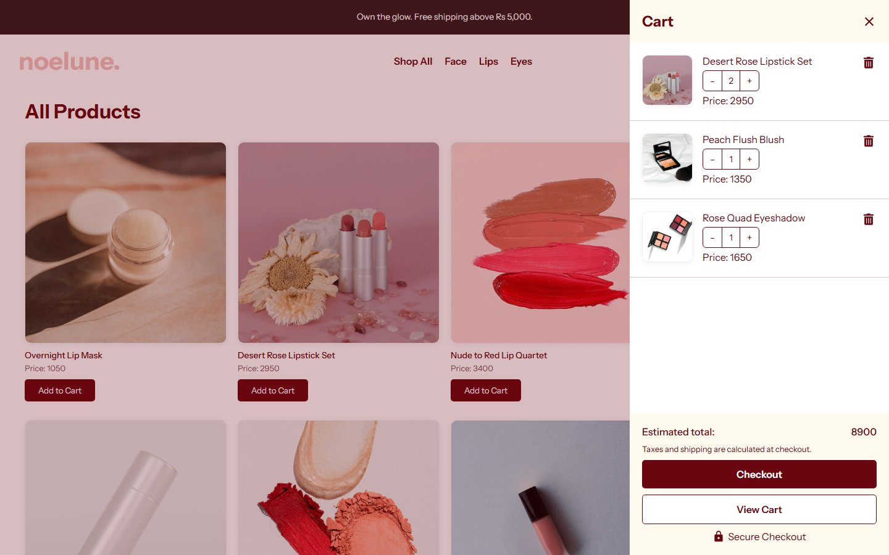
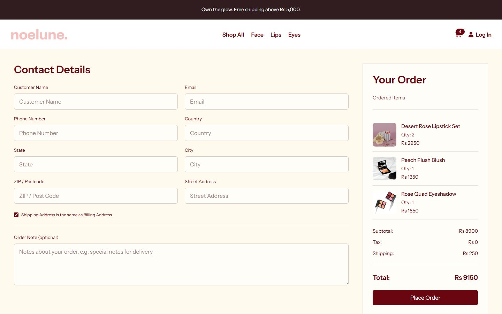

<div align="center">

# noelune. — Beauty E-Commerce Store

A full-stack e-commerce web app with a customer storefront and an admin dashboard,<br/>
built with **React**, **Node.js / Express** and **MongoDB**.

[**Live Demo**](https://ecommerce-react-app-pink-five.vercel.app) · [**API**](https://ecommerce-api-three-omega.vercel.app/health) · [Run Locally](#-getting-started)


</div>

---

## 📖 About

**noelune.** is a fictional beauty brand I created to showcase a complete online store, from browsing products to placing an order and managing everything from an admin panel.

The React frontend talks to a **Node.js / Express** REST API backed by **MongoDB Atlas**. Product images are stored on **Cloudinary**, and customers get an order confirmation email through **EmailJS**. The same API is also written in **Python (FastAPI)**, and the repo includes **Terraform** config for AWS.

---

## ✨ Features

### 🛍️ Storefront
- Home page with a hero banner, new arrivals and a customer testimonial
- Shop all products or filter by category (**Face**, **Lips**, **Eyes**)
- Product details page with quantity selector, *Add to Cart* and *Buy Now*
- Slide-out cart and full cart page with live quantity updates and totals
- Cart saved in the browser, so it survives a page refresh
- Checkout with billing and shipping details (or "same as billing")
- Order confirmation email sent to the customer
- Customer sign up and log in

### 🛠️ Admin Dashboard
- Separate admin login with role-based access
- Dashboard overview with product and category counts
- Add, edit and delete products, with image upload to Cloudinary
- Manage categories
- View all orders and update their status: *pending → processing → delivered / cancelled*

### ⚙️ Under the Hood
- JWT authentication, passwords hashed with bcrypt
- Protected admin routes (`authMiddleware` + `adminMiddleware`)
- Image uploads handled with Multer and streamed to Cloudinary
- Seed script that loads a full demo catalogue of 37 products
- Express app runs as a serverless function on Vercel, with a daily keep-alive cron
- The same API also built in FastAPI, plus Docker and Terraform (AWS EC2 + S3) setup

---

## 📸 Screenshots

| Shop All | Product Details |
| :---: | :---: |
|  |  |
| **Cart** | **Checkout** |
|  |  |

---

## 🧑‍💻 Tech Stack

| Layer | Technologies |
| --- | --- |
| **Frontend** | React 19, Vite, React Router, Material UI, Axios, Motion, SweetAlert2 |
| **Backend** | Node.js, Express 5, MongoDB Atlas + Mongoose, JWT, bcrypt, Multer |
| **Services** | Cloudinary (images), EmailJS (order emails) |
| **Backend (Python)** | FastAPI, Motor + Beanie, PyJWT, passlib |
| **DevOps** | Vercel, Docker, Terraform (AWS EC2 + S3) |

---

## 📁 Project Structure

```
ecommerce-react-app/
├── frontend/        React app: storefront + admin dashboard
├── backend/         Node.js / Express REST API (used by the frontend)
│   └── scripts/     Demo data seed script
├── backend-py/      Python / FastAPI version of the same API
├── terraform/       AWS infrastructure (EC2 + S3)
└── docs/            README screenshots
```

---

## 🚀 Getting Started

### Prerequisites
- Node.js 18+
- A MongoDB database (e.g. a free MongoDB Atlas cluster)
- A Cloudinary account and an EmailJS account

### 1. Clone the repo
```bash
git clone https://github.com/sumaira-tabassum/ecommerce-react-app.git
cd ecommerce-react-app
```

### 2. Start the backend
```bash
cd backend
cp .env.example .env    # fill in your values
npm install
npm start               # http://localhost:5000
```

### 3. Start the frontend
```bash
cd frontend
cp .env.example .env    # VITE_BASE_URL=http://localhost:5000
npm install
npm run dev             # http://localhost:5173
```

### 4. (Optional) Load the demo products
```bash
cd backend
node scripts/seedProducts.js
```
This uploads the product photos to Cloudinary and **replaces all products** in the database with the 37-item demo catalogue.

An admin account is created automatically the first time the API starts (see [`backend/utils/seedAdmin.js`](backend/utils/seedAdmin.js)).

<details>
<summary><b>Run the Python (FastAPI) backend instead</b></summary>

```bash
cd backend-py
python -m venv venv
venv\Scripts\activate          # macOS/Linux: source venv/bin/activate
pip install -r requirements.txt
cp .env.example .env
uvicorn main:app --reload --port 5000
```
It exposes the same `/api/*` routes, so the frontend works with it unchanged.
</details>

---

## 🔑 Environment Variables

**`backend/.env`** (same keys for `backend-py/.env`)

| Variable | Description |
| --- | --- |
| `MONGO_URI` | MongoDB connection string |
| `PORT` | API port (default `5000`) |
| `JWT_SECRET` | Secret used to sign login tokens |
| `CLOUD_NAME`, `API_KEY`, `API_SECRET` | Cloudinary credentials |
| `EMAILJS_PUBLIC_KEY`, `EMAILJS_PRIVATE_KEY`, `EMAILJS_SERVICE_ID`, `EMAILJS_TEMPLATE_ID` | EmailJS settings for order emails |

**`frontend/.env`**

| Variable | Description |
| --- | --- |
| `VITE_BASE_URL` | URL of the API, e.g. `http://localhost:5000` |

---

## ☁️ Deployment

Both apps are deployed on **Vercel** as two projects from this repo:

- **API** — root directory `backend`. [`vercel.json`](backend/vercel.json) runs Express as a serverless function and pings the API once a day to keep it warm.
- **Frontend** — root directory `frontend`, with `VITE_BASE_URL` pointing to the API. [`vercel.json`](frontend/vercel.json) handles client-side routing.
- **AWS (alternative)** — [`terraform/`](terraform) provisions an EC2 instance for the API and an S3 bucket for the frontend. The API also includes a [`Dockerfile`](backend/Dockerfile).

---

## 🗺️ Roadmap

- [ ] Product shades and variants
- [ ] Save the cart to the user's account
- [ ] Online payments (e.g. Stripe)
- [ ] Customer order history and tracking
- [ ] Sales analytics on the admin dashboard

---

## 🙏 Credits

- **noelune.** is a fictional brand made for this project.
- Product photos are from [Unsplash](https://unsplash.com) and are used under the Unsplash License.

<div align="center">

Made with 💗 by [Sumaira Tabassum](https://github.com/sumaira-tabassum)

</div>
